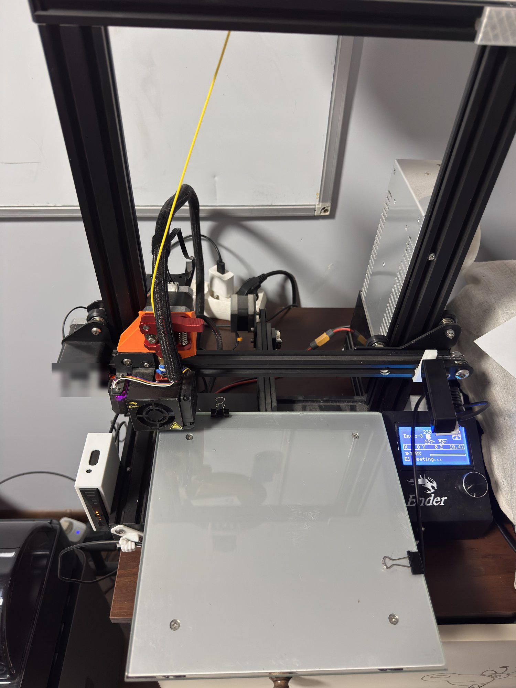
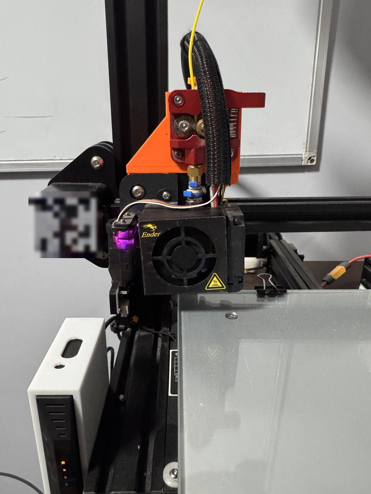
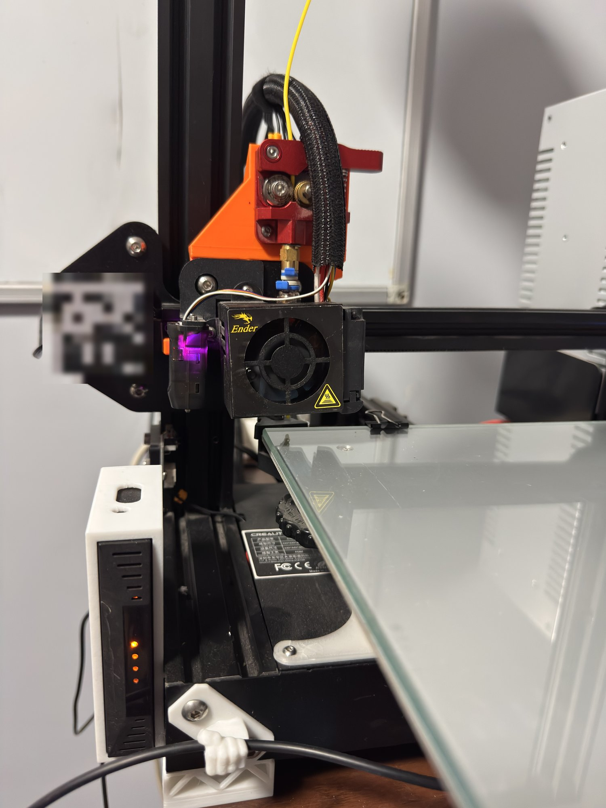

# Ender 3 (Creality 4.2.7) + BLTouch + Direct Drive: Marlin 2.1.2.5

Ready-to-flash Marlin firmware for a **Creality Ender 3** with the silent **4.2.7** board,
a **BLTouch** on the board's dedicated 5-pin port, and a **direct drive** conversion with a
carriage bumper ([Thingiverse 3816051](https://www.thingiverse.com/thing:3816051)).

## Photos

| Overview | Direct drive head | Side view |
|---|---|---|
|  |  |  |

Stock Creality extruder moved onto the X carriage with a printed mount, BLTouch on the left of the
hotend (offset X −45, Y 0).

## The problem this solves

After the direct drive conversion and adding the bumper:

- the X carriage runs out of travel early (here it touches at **X 206** instead of 235),
- Z travel dropped by roughly 40 mm,
- the stock Creality firmware (Marlin 2.0.6) still assumes the full range. During `G29` the head
  crashes into the bumper, the stepper grinds and skips steps, and every probe point after that
  is wrong, so the mesh comes out as garbage.

## Changes vs. the stock example config

Base: [MarlinFirmware/Configurations `release-2.1.2.5`](https://github.com/MarlinFirmware/Configurations/tree/release-2.1.2.5/config/examples/Creality/Ender-3/CrealityV427)
→ `Creality/Ender-3/CrealityV427`.

| Setting | Value | Why |
|---|---|---|
| `X_BED_SIZE` / `X_MAX_POS` | **204** (was 235) | bumper touches at 206, 2 mm margin |
| `Z_MAX_POS` | **210** (was 250) | reduced Z travel after the conversion |
| `BLTOUCH` | enabled | probe on the 5-pin port (PB1) |
| `Z_MIN_PROBE_USES_Z_MIN_ENDSTOP_PIN` | disabled | probe is not on the Z endstop connector |
| `USE_PROBE_FOR_Z_HOMING` + `Z_SAFE_HOMING` | enabled | Z homes with the probe at bed center |
| `NOZZLE_TO_PROBE_OFFSET` | `{ -45, 0, 0 }` | probe sits 45 mm left of the nozzle |
| `AUTO_BED_LEVELING_BILINEAR` | **5×5** grid | |
| `LCD_BED_LEVELING` | enabled | leveling from the LCD menu |
| `PROBE_OFFSET_WIZARD` | enabled | Z offset wizard in the LCD menu |
| `BABYSTEP_ZPROBE_OFFSET` | enabled | babystepping adjusts the Z offset directly |
| `Z_MIN_PROBE_REPEATABILITY_TEST` | enabled | `M48` |
| `DEFAULT_AXIS_STEPS_PER_UNIT` E | 92.6 | |

Exact changes: [`config/Configuration.h.diff`](config/Configuration.h.diff) and
[`config/Configuration_adv.h.diff`](config/Configuration_adv.h.diff). Full files are in [`config/`](config/).

> **Your printer may have different limits.** Check where *your* carriage hits the bumper:
> *Motion → Move Axis → X*, step 1 mm at a time. If it's not 206, rebuild with your own value
> (see below). A `X_BED_SIZE` that's too large means crashing into the bumper again.

## Flashing

1. FAT32 SD card with **only** `firmware/firmware-*.bin` in the root directory.
   The 4.2.7 board needs a new filename for every flash; the timestamp in the name takes care of that.
2. Power off, insert the card, power on. The screen stays black for 10–30 s.
3. When asked about the EEPROM, choose **Reset**.
4. Restore your settings, e.g. with [`gcode/post_flash.gcode`](gcode/post_flash.gcode) using
   **your** E-steps (read them with `M503` before flashing).
5. **Run the hotend PID autotune**: [`gcode/pid_hotend.gcode`](gcode/pid_hotend.gcode) (5–8 min).
6. Set the Z offset: *Configuration → Probe Offsets → Z Probe Wizard* → *Store Settings*.
7. Cura → Machine Settings: **Width 204, Height 210**.

Cura start G-code:
- [`gcode/start_gcode_cura.gcode`](gcode/start_gcode_cura.gcode): runs `G29` before every print (+1.5–2 min),
- [`gcode/start_gcode_cura_fast.gcode`](gcode/start_gcode_cura_fast.gcode): `M420 S1`, loads the saved
  mesh without probing. Re-mesh (`G29` + `M500`) after adjusting the bed knobs or every few weeks.

## Cura settings after switching to direct drive

**Preferences → Printers → Machine Settings:** Width (X) **204**, Depth (Y) **235**, Height (Z) **210**.

Bowden retraction (5–6 mm) is far too much for direct drive:

| Setting | PLA / PETG | TPU 93A |
|---|---|---|
| Printing Temperature | per manufacturer | 225–235°C |
| Build Plate Temperature | 60 / 75°C | 50°C |
| Print Speed | 50–60 mm/s | 20–30 mm/s |
| Initial Layer Speed | 20 mm/s | 15 mm/s |
| Retraction Distance | ~1 mm | 0.8–1 mm |
| Retraction Speed | 35–40 mm/s | 20–25 mm/s |
| Combing Mode | Not on Outer Surface | Not on Outer Surface |
| Fan Speed | 100% / 50% | 30–50% |

TPU: loosen the extruder tension a bit, dry the filament (50°C, 4–6 h), no glue on PEI.

## Troubleshooting notes

- **`Error:Probing Failed` right after a bumper crash:** the BLTouch was in alarm mode (blinking red).
  `M280 P0 S160` (alarm reset) or a power cycle fixes it.
- **`Heating Failed E1`, hotend stalls around 220°C:** caused by PID values carried over from the
  stock Creality firmware (`M301 P10.30 I0.53 D49.80`). On Marlin 2.1 they're too weak: close to the
  target the heater only gets ~30% power. After `M303 E0 S210 C8 U1` (fan at 100%) I got
  `P27.80 I2.59 D74.51` and the hotend holds 228°C ±1°C.
- **Large left–right tilt** (~3.5 mm here, almost flat front–back): the heavier direct drive head
  can tilt the X gantry, since there's only one Z leadscrew on the left. Roughly correct it with the
  bed knobs or the eccentric nut on the right gantry roller; the mesh handles the rest. With a large
  tilt, disable fade: `M420 S1 Z0` + `M500`.
- The rightmost reachable probe point is X 159 (204 − 45 probe offset). Beyond that the mesh is extrapolated.
- `M304` (bed PID) and `M413` (power-loss recovery) are disabled in this config; the bed uses bang-bang.

## Building it yourself

```bash
git clone -b 2.1.2.5 https://github.com/MarlinFirmware/Marlin.git
cp config/Configuration.h config/Configuration_adv.h Marlin/Marlin/
cd Marlin
# optionally adjust X_BED_SIZE / Z_MAX_POS / NOZZLE_TO_PROBE_OFFSET
pio run -e STM32F103RE_creality
# output: .pio/build/STM32F103RE_creality/firmware-*.bin
```

## License

Marlin is licensed under GPL-3.0 (see [LICENSE](LICENSE)). Marlin source code:
<https://github.com/MarlinFirmware/Marlin/tree/2.1.2.5>.
The configuration in this repo is derived from the MarlinFirmware/Configurations examples.

Use at your own risk. Stay next to the printer during the first `G29`.
